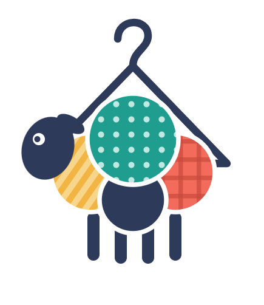

# 👗 Sharely — Digitaler Kleiderschrank



**Sharely** ist ein digitaler Kleiderschrank als Web-App. Dabei kann man seine Kleidungsstücke fotografieren und bildlich in seinen virtuellen Kleiderschrank einpflegen. Einige Eigenschaften der Klamotten lassen sich mithilfe einer **KI-Bilderkennung** automatisch zuordnen. Diese Teile lassen sich zu **Outfits** zusammenstellen und man kann sie mit **Freunden teilen**. Daneben kann man auch ausgewählte Kleidungsstücke und Outfits an Freunde **verleihen oder verschenken**.

Das Herzstück des Projekts ist ein **frei anpassbarer 3D-Avatar**, der die ausgewählte Kleidung trägt und anzeigt, wie sie unter Berücksichtigung der Maße passt. Dazu kommt die Möglichkeit, neben dem digitalen Anprobieren der eigenen Klamotten und der der Freunde, das Anprobieren von Artikeln unserer Geschäftspartner. Diese stehen zum Anprobieren kostenlos in unserem Shop zur Verfügung.

> [!IMPORTANT]
> Über unsere Anwendung ist der Kauf von Klamotten **nicht** möglich!

## ✨ Alleinstellungsmerkmale

- 🤝 **Verleihen, verschenken und teilen** der Klamotten mit Freunden
- 🤖 **Automatische Zuordnung** von Kleidungseigenschaften mit KI
- 🧍 **Digitales Anprobieren** durch den 3D-Avatar inkl. Passform-Check und Simulation

## 👥 Team

| Name | Rolle |
|---|---|
| Katharina Lutzky (Katha) | Repo-Inhaberin |
| Manuel Herrmann (Manu) | |
| Christian Maschke (Chris) | |

## 🚀 Starten

So kann die Anwendung aktuell sauber gestartet werden:

```bash
cd Sharely_programm
python start.py
```

`start.py` ist der einzige Einstiegspunkt: Es startet das Backend (Port 8000) und den Seiten-Server (Port 5173) und öffnet den Browser. **Strg+C** beendet alles.

- Die einmalige Einrichtung (Pakete, `.env`, Datenbank) steht in [`Sharely_programm/backend/README.md`](Sharely_programm/backend/README.md).
- Die App unter **http://localhost:5173** öffnen, nicht unter `127.0.0.1`.

## 📁 Projektstruktur

```
├── README.md              diese Datei
├── BRAIN.md               gemeinsames Team-Gedächtnis: Stand, offene Entscheidungen, Log
├── CLAUDE.md              Projektkontext für die Claude-Sitzungen
├── Sharely_programm/      alles, was die App zum Laufen braucht
│   ├── start.py           startet alle Dienste mit einem Befehl
│   ├── seiten_server.py   liefert die Seiten aus (Port 5173)
│   ├── backend/           Python-Code (FastAPI), Tests, requirements.txt
│   ├── frontend/          HTML-Seiten, CSS, JavaScript, 3D-Avatar-Editor (Three.js)
│   ├── assets/            Bild- und Avatardateien
│   └── uploads/           hochgeladene Bilder, nur lokal, nicht im Repo
└── docs/                  sämtliche Projektdokumentationen
```
