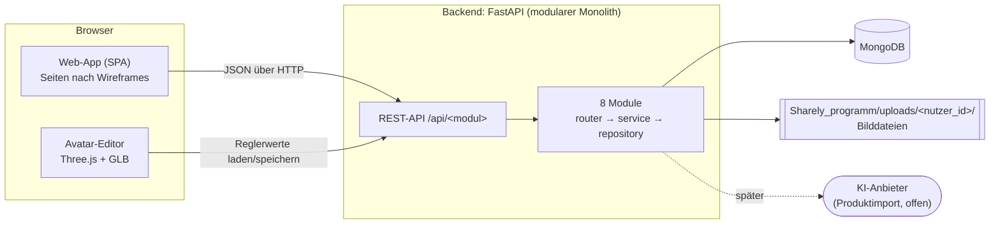
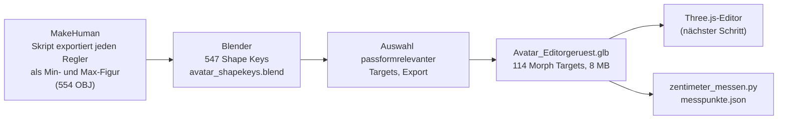

# Projektdokumentation — Sharely

**Sharely — digitale Kleiderschrankverwaltung mit anpassbarem 3D-Avatar**

Abschlussprüfungsprojekt · Team: Katharina Lutzky, Manuel Herrmann, Christian Maschke · Projektzeitraum: 26 Wochen, Juli 2026 bis Anfang Januar 2027

Stand: 20.10.2026 (Projektwoche 15 von 26) · erstellt von Katha/Claude(Laptop.Code) aus dem Projektverlauf im Repository (Git-Historie, `BRAIN.md`-Log und Fachdokumente)

> **Wie dieses Dokument gepflegt wird:** Die Projektdokumentation fasst den Projektverlauf zusammen und verweist für Details auf die Fachdokumente im Repo. Sie ersetzt keines davon. Neue Entscheidungen zuerst im zuständigen Fachdokument und in `BRAIN.md` festhalten, dann hier in Kapitel 9 (Entscheidungsprotokoll) und ggf. Kapitel 10 nachziehen. Stellen mit **[vom Team zu ergänzen]** kann nur das Team selbst ausfüllen (z. B. Rahmenbedingungen der Prüfung, Fazit).

---

## Inhalt

1. [Einleitung](#1-einleitung)
2. [Projektplanung](#2-projektplanung)
3. [Analyse](#3-analyse)
4. [Entwurf](#4-entwurf)
5. [3D-Avatar (Kernfeature)](#5-3d-avatar-kernfeature)
6. [Umsetzung](#6-umsetzung)
7. [Qualitätssicherung](#7-qualitätssicherung)
8. [Datenschutz und Sicherheit](#8-datenschutz-und-sicherheit)
9. [Entscheidungsprotokoll](#9-entscheidungsprotokoll)
10. [Projektverlauf: Soll-Ist-Vergleich](#10-projektverlauf-soll-ist-vergleich)
11. [Offene Punkte und Ausblick](#11-offene-punkte-und-ausblick)
12. [Fazit](#12-fazit)
13. [Anhang](#13-anhang)

---

## 1. Einleitung

### 1.1 Projektumfeld

Sharely entsteht als Abschlussprüfungsprojekt eines dreiköpfigen Teams über 26 Wochen. Das Team arbeitet verteilt an eigenen Rechnern; zentrale Quelle für Code und Dokumentation ist das GitHub-Repository `Kathamesser/digitaler-Kleiderschrank`. Jedes Teammitglied setzt KI-Assistenz (Claude Code, Claude Cowork) ein; wie das organisiert und nachvollziehbar gemacht wird, beschreibt Abschnitt 2.4.

**[vom Team zu ergänzen]:** Ausbildungsberuf/Bildungsgang, Schule bzw. prüfende Stelle, Betreuende Lehrkraft, formale Vorgaben zu Umfang und Abgabe.

### 1.2 Ausgangssituation und Projektbegründung

Viele Menschen haben keinen Überblick über ihre Kleidung: Teile werden vergessen, doppelt gekauft oder passen beim Onlinekauf nicht. Bestehende Kleiderschrank-Apps verwalten meist nur Fotos. Sharely („style and share“) verbindet drei Dinge:

- den **eigenen Kleiderschrank digital** zu erfassen und zu Outfits zu kombinieren,
- Kleidung mit **Freunden zu teilen, zu verleihen und zu verschenken**,
- und als Alleinstellungsmerkmal einen **frei anpassbaren 3D-Avatar**, der die ausgewählte Kleidung trägt und mit seinen Körpermaßen eine Passform-Bewertung („passt / eng / weit“) gegen Größentabellen ermöglicht.

### 1.3 Projektziel

Eine responsive Web-App (Desktop und Smartphone), mit der Nutzer

1. Kleidungsstücke per Foto erfassen, kategorisieren, filtern und als Favorit markieren,
2. Teile zu Outfits kombinieren und speichern,
3. Wunschartikel per KI aus Produktlink oder Beschreibung importieren,
4. eine Sims-artige 3D-Spielfigur nach eigenem Körperbau gestalten, die die Kleidung trägt und die Passform anzeigt,
5. Kleidungsstücke mit Freunden teilen, verleihen und verschenken.

Die vier Säulen der Roadmap (Kleiderschrank, Outfit-Kombinatorik, KI-Produktimport, Avatar-Baukasten) sind in `docs/planung/ROADMAP.md` beschrieben, die sozialen Funktionen (Freunde, Verleihen, Verschenken) kamen über User Storys und die Technische Konzeption hinzu (siehe Abschnitt 11.1).

### 1.4 Projektabgrenzung

Bewusst **nicht** Teil des Projekts:

- **Keine Foto-Avatare und keine echten Körperfotos.** Der Avatar wird von Hand über Regler angepasst (Entscheidung Juli 2026, Begründung in 9 und 8).
- **Kein eigenes Virtual-Try-On-KI-Modell**, keine Unity- oder native App.
- **Keine 1:1-Rekonstruktion** jedes fotografierten Kleidungsstücks in 3D: Kleidung wird einer begrenzten Zahl vorgefertigter 3D-Vorlagen zugeordnet und eingefärbt.
- **Keine App-Store-App;** die Web-App kann später optional als PWA installiert werden.
- Frisuren und Gesichter nur als begrenzte, kuratierte Auswahl (6–8 Presets je Kategorie), kein frei generierbares System.

---

## 2. Projektplanung

### 2.1 Projektphasen (Soll)

Der Meilensteinplan aus `docs/planung/ROADMAP.md` (erstellt 09.07.2026) teilt das Projekt in acht Phasen. Die Daten ergeben sich aus Projektwoche 1 = 09.07.2026.

| Phase | Wochen | Zeitraum | Inhalt |
|---|---|---|---|
| 0 Analyse & Konzept | 1–3 | 09.07.–29.07. | Lasten-/Pflichtenheft, User Stories, grobes Datenmodell, Tech-Stack |
| 1 Architektur, API & Design | 4–6 | 30.07.–19.08. | API-Spezifikation, Datenbankschema, Wireframes, Repo/CI, Avatar-Machbarkeitsprototyp |
| 2 Kleiderschrank-Kernfunktion | 7–10 | 20.08.–16.09. | Login, Bild-Upload, Kleidungsverwaltung, Schrankansicht |
| 3 Avatar-Grundgerüst | 11–16 | 17.09.–28.10. | 3D-Humanoid mit Morph Targets, Regler, Farben, Presets, 360°-Viewer, Speichern |
| 4 Outfits & Kleidungs-Fitting | 17–19 | 29.10.–18.11. | 3D-Vorlagen, Skalierung, Einfärben, Passform, Outfits verwalten |
| 5 KI-Produktimport & Wunschliste | 20–22 | 19.11.–09.12. | Link/Text-Import, KI-Extraktion inkl. Größentabelle, Wunschliste |
| 6 Integration & Feinschliff | 23–24 | 10.12.–23.12. | Zusammenführen, End-to-End-Tests, Performance |
| 7 Test, Dokumentation & Abgabe | 25–26 | 24.12.–06.01.2027 | Testkonzept, Doku, Präsentation, Demo-Deployment |

Laufend über alle Phasen: Datenschutz, Dokumentation der Entscheidungen, wöchentlicher Team-Sync. Den tatsächlichen Verlauf zeigt Kapitel 10.

### 2.2 Vorgehensmodell

Agil-iterativ mit User Storys und Kanban-Board auf GitHub (je User Story ein Issue, dazu Issue #11 „Definition of Done“). Die Arbeit wird in Sprints geplant (erstes Sprint Planning am 06.10.2026 mit den Aufgaben Datenbankmodell festlegen, Datenbank erstellen, Mockups erstellen); die Sprint-Planung selbst wird auf Wunsch des Teams nicht im Repo geführt.

### 2.3 Rollen und Ressourcen

Rollen sind laut Roadmap „grob aufgeteilt, nicht zementiert“. Tatsächliche Schwerpunkte bisher:

| Person | Schwerpunkt im bisherigen Verlauf |
|---|---|
| Katharina Lutzky (Katha) | Repo-Inhaberin, User Storys, Wireframes, Projektgerüst, erstes Feature (User Story 8), Klick-Prototyp |
| Manuel Herrmann | Datenmodell (ERM und MongoDB-Abbildung) |
| Christian Maschke | Roadmap und Avatar-Konzept, 3D-Avatar-Pipeline (MakeHuman → Blender → GLB), Zentimeter-Messung, KI-Arbeitsorganisation (`BRAIN.md`) |

Werkzeuge: VS Code, Git/GitHub, Python 3 mit FastAPI, MongoDB (lokal oder MongoDB Atlas), MakeHuman und Blender (Asset-Bau), draw.io (ERM), Claude Code und Claude Cowork als KI-Assistenz.

### 2.4 Arbeitsorganisation und KI-Einsatz

Weil drei Menschen mit mehreren KI-Sitzungen parallel arbeiten, hat das Team früh Regeln eingeführt, damit nichts zwischen den Sitzungen verloren geht (alle in `BRAIN.md`):

- **`BRAIN.md` als gemeinsames Team-Gedächtnis** (seit 17.07.2026): aktueller Stand, offene Entscheidungen, wer woran arbeitet, Wissensspeicher und ein Log aller Aktionen.
- **Protokollpflicht** (seit 15.09.2026): Jede KI-Sitzung trägt jede Aktion mit Datum und **Sitzungskennung** `Mensch/KI(Gerät.Anwendung)` ins Log ein, z. B. `Christian/Claude(Laptop.Code)`. So bleibt prüfbar, wer was mit welchem Werkzeug getan hat.
- **Nur eine gültige `BRAIN.md` auf `main`** (seit 15.09.2026), nachdem eine Cloud-Sitzung auf einem eigenen Branch gearbeitet hatte und für die anderen unsichtbar blieb.
- **`CLAUDE.md`** gibt jeder Claude-Sitzung den Projektkontext und verweist auf `BRAIN.md`.
- **KI-Vorschläge werden gekennzeichnet:** Von der KI entworfene Inhalte (z. B. Anforderungen der User Storys 5–10) stehen als „Vorschlag von Claude“ im Dokument, bis das Team sie geprüft hat. Entscheidungen treffen immer die Teammitglieder.

---

## 3. Analyse

### 3.1 Ist-Zustand

Zu Projektbeginn gab es keinen Code nach Zielbild. In der Testphase (15./16.07.2026) entstand ein Experimentierstand als Flask-Webapp mit SQLite und Server-Templates. Er war nie das Zielbild und wurde am 06.10.2026 vollständig entfernt (in der Git-Historie nachlesbar), weil SQLite für mehrere Nutzer und flexible Kleidungsattribute weniger geeignet ist und die Zielarchitektur Backend und Frontend trennt (Technische Konzeption 2.2).

### 3.2 Use Cases

Die Technische Konzeption vom 04.10.2026 (`docs/konzeption/Technische_Konzeption_Sharely.pdf`, Kapitel 1) enthält vier Use-Case-Diagramme:

1. Gesamtübersicht
2. Account und Anmeldung
3. Kleiderschrank und Outfits
4. Freunde, Verleihen und Verschenken

### 3.3 Anforderungen (User Storys)

Die User Storys stammen aus dem GitHub-Kanban-Board und stehen vollständig mit Anforderungen in `docs/planung/Userstory.md`.

| Nr. | User Story | Anforderungen | Umsetzungsstand (20.10.2026) |
|---|---|---|---|
| 1 | Kleiderschrank-Übersicht | vom Team | Liste und Detail im Backend, Schrankseite mit Suche und Filter im Prototyp |
| 2 | Kleiderschrank mit Freunden teilen | vom Team | offen; ob umgesetzt wird, ist offene ERM-Frage |
| 3 | Kleidungssimulation (Avatar) | vom Team | Avatar-Rohling fertig, Editor folgt |
| 4 | Kleidungsstücke/Outfits kennzeichnen (Herz) | vom Team | Favorit am Kleidungsstück umgesetzt, Outfits offen |
| 5 | Nach Kategorie filtern | Vorschlag Claude | Filter im Prototyp (im Browser) |
| 6 | Login/Logout | Vorschlag Claude | **umgesetzt** (27.10.2026): Registrierung, Login, Logout |
| 7 | Passwort zurücksetzen | Vorschlag Claude | offen |
| 8 | Kleidungsstück digitalisieren | Vorschlag Claude | **umgesetzt** (13.10.2026) |
| 9 | Kleidungsstück verleihen | Vorschlag Claude | offen, im ERM modelliert |
| 10 | Kleidungsstück verschenken | Vorschlag Claude | offen, im ERM modelliert |

Nicht-funktionale Anforderungen (aus Konzeption und Roadmap): im Browser lauffähig und responsiv, 3D-Darstellung flüssig auf der Grafikkarte des Nutzers, personenbezogene Daten in der eigenen Datenbank statt bei Drittanbietern, verständliche deutsche Fehlermeldungen, wartbar durch klare Modulgrenzen.

### 3.4 Anforderungen an den Avatar

Vorgabe aus dem Team (`docs/planung/ROADMAP.md`): 3D-Modell von allen Seiten betrachtbar (Drehen/Zoomen); anpassbar in Größe, Körperbau, Haut-, Haar- und Augenfarbe, Frisur und Gesicht; anpassbare Körpermaße (Schultern, Taille, Beine, Brust), die auch für die Passform-Bewertung dienen.

---

## 4. Entwurf

### 4.1 Art der Anwendung

**Web-App** als Single-Page-Anwendung, responsiv für Desktop und Smartphone (Technische Konzeption 2.1). Begründung: interaktive Funktionen mit Login, eine Codebasis, Updates sofort für alle, kein App-Store-Prozess, Web-Kenntnisse im Team vorhanden, WebGL und Kamera-Upload in modernen Browsern verfügbar.

### 4.2 Technologie-Stack

| Ebene | Technologie | Begründung (Kurzfassung) | Entschieden |
|---|---|---|---|
| Backend | Python mit FastAPI | größte Teamerfahrung, gutes Ökosystem für KI-APIs und Scraping, automatische API-Doku | 12.07.2026 |
| Datenbank | MongoDB (lokal oder Atlas) | Kleidungsstücke mit variablen Attributen und Avatar-Konfiguration passen zum Dokumentenmodell, im Team bekannt | 12.07.2026 |
| Bildspeicher | Dateien auf dem Server, je Nutzer ein Ordner; in der DB nur der Pfad | Bilder gehören nicht in die Datenbank | 04.10.2026 |
| Frontend | JavaScript, HTML/CSS | Browserstandard | 12.07.2026 |
| 3D | Three.js | läuft im Browser ohne Plugin, unterstützt glTF-Morph-Targets, große Community | 12.07.2026 |
| Frontend-Framework | React oder Vue | **noch offen** | – |
| KI-Anbieter Produktimport | – | **noch offen** | – |

Bewusste Konsequenz: zwei Sprachen (Python im Backend, JavaScript im Frontend) — üblich für Webprojekte und eine saubere Arbeitsteilung.

### 4.3 Architektur

**Client-Server-Architektur mit einem modular aufgebauten Monolithen** als Backend und einer REST-API (Technische Konzeption 2.3).

- Die rechenintensive 3D-Darstellung läuft im Browser auf der Grafikkarte des Nutzers, der Server liefert nur Daten.
- Frontend und Backend können über die REST-API parallel von verschiedenen Teammitgliedern entwickelt werden.
- Das Backend besteht aus acht Fachmodulen: `nutzer`, `kleidung`, `outfits`, `freunde`, `verleihen`, `figuren`, `produktimport`, `passform`. Jedes Modul hat dieselben Schichten: `router.py` (HTTP) → `service.py` (Geschäftslogik) → `repository.py` (einziger Datenbankzugriff), dazu `schemas.py` (Pydantic-Modelle). Module rufen sich nur über ihre Services auf. Dadurch ließe sich z. B. der KI-Import später als eigener Dienst herauslösen.
- Details: `Sharely_programm/backend/README.md`.

### 4.4 Datenmodell

Das ERM hat Manuel erstellt (`docs/datenmodell/ERM-SHARELY.md`, Diagramme in `ERM_Sharely.drawio` bzw. `erm_sharely.png` und `erm_teil3_mongodb.png`). Die erste Fassung vom 13.10.2026 beruhte auf den Wireframes der Technischen Konzeption. Am 20.10.2026 hat Manuel es an die Desktop-Mockups (`docs/mockups/desktop/`) angepasst und festgelegt; wo Mockups und Wireframes voneinander abweichen, gelten die Mockups. Offen waren danach nur noch zwei Punkte, die die Struktur nicht ändern: welche Maße je Kleidungsart erfasst werden und welche Kleidungsart welche 3D-Vorlage nutzt. Den ersten hat Christian am 26.10.2026 mit Startwerten umgesetzt (Messpunkte und Zugaben je Kleidungsart, siehe unten; Bestätigung durch Manuel steht aus), der zweite ist weiter offen.

**Entitäten:** Nutzer, Sitzung, Passwort-Reset, Figur, Freundschaft, Kleidungsstück, Kleidungsart, Kleidungsvorlage, Farbe, Material, Saison, Kategorie, Kleidungsmaß, Messpunkt, Produktquelle, Outfit, Leihvorgang, Neuigkeit, Ausgeblendete Kategorie; n:m-Beziehungen über Zuordnungstabellen.

Wichtige Designentscheidungen (Begründungen in `ERM-SHARELY.md` Abschnitt 5):

- **Kleidungsart als Pflicht-Einordnung** (feste Liste: Tops, Pullover, Hosen, Röcke, Kleider, Jacken, Schuhe, Unterwäsche, Einteiler, Accessoires). Sie bestimmt die 3D-Vorlage, mehrere Arten können sich eine Vorlage teilen.
- **Kategorien als freie Etiketten:** vorgegebene (Business, Freizeit, Winterkleidung …) und eigene je Nutzer, mehrere je Kleidungsstück oder Outfit. Der Anlass geht darin auf. Jeder Nutzer kann Kategorien für sich ausblenden.
- **Feste Wertelisten** für Farbe, Material und Saison: im ERM als Wertetabellen (1. Normalform), in MongoDB als Enum im Code.
- **Maße an den Messbändern des Avatars:** Ein Kleidungsstück speichert seine Maße in cm an denselben 24 Messpunkten wie die Avatar-GLB (22 bis zum 20.10.2026, dann ergänzt um Schulterbreite über den Rücken und Armlänge). Die Passform („passt / eng / weit“) vergleicht Messpunkt für Messpunkt ohne Umrechnung; Größentabellen entfallen.
- **Messpunkte und Zugaben je Kleidungsart (26.10.2026, Christian):** Jede Kleidungsart kennt ihre Messpunkte, jeweils Pflicht (bestimmt die Passform-Ampel) oder optional (nur Hinweis), mit einer Zugabe-Spanne für „passt“: Umfänge in Prozent des Körpermaßes, Längen in cm, weil die nötige Bewegungszugabe mit der Körpergröße wächst. Startwerte aus einer Recherche zur Schnittkonstruktion, sie werden nach Tests mit echten Teilen angepasst (`docs/datenmodell/ZUGABEN.md`, Werte in `wertelisten.MESSPUNKTE_JE_KLEIDUNGSART`, in der Datenbank an `kleidungsarten.messpunkte`).
- **Status** `im_schrank`, `geliehen`, `verliehen`, `wunsch`. Wunschartikel und geliehene Teile sind Kleidungsstücke im eigenen Schrank; ein geliehenes Teil verweist auf seinen Leihvorgang.
- **Leihvorgang als eigene Entität** mit Verlauf (Anfrage, Annahme, Zeitraum, Rückgabe). **Verschenken ist ein Besitzwechsel:** Das Teil gehört danach dem Empfänger, der Verlauf bleibt im Leihvorgang.
- **Gegenseitige Freundschaft** mit Anfrage, Annehmen, Ablehnen und Blockieren. Freunde sehen alle Teile und Outfits außer privaten.
- **Neuigkeiten** des Entwicklerteams; anlegen dürfen nur Admins (`Ist_Admin`, nur direkt in der Datenbank setzbar).
- **Berechnetes wird nicht gespeichert:** Zähler, „überfällig“, Passform-Bewertung, Zentimeter der Figur.

**Abbildung auf MongoDB:** Jede Entität mit eigenem Lebenszyklus wird eine Collection (`nutzer`, `kleidungsstuecke`, `kleidungsarten`, `kategorien`, `outfits`, `figuren`, `freundschaften`, `leihvorgaenge`, `neuigkeiten` …). Eingebettet wird nur, was ausschließlich zu einem Dokument gehört (Maße, Produktquelle, Outfit-Teile, Reglerwerte); kleine feste Listen ohne eigene Daten stehen im Code. Da MongoDB keine Fremdschlüssel kennt, prüft die Service-Schicht die Regeln selbst, z. B. höchstens drei Figuren je Nutzer, Leihen nur unter Freunden oder nie Einblick in private Teile (`ERM-SHARELY.md` Abschnitt 7).

**Umsetzung in der Datenbank (20.10.2026):** Die Struktur ist im Backend beschrieben (`Sharely_programm/backend/app/core/datenbank_struktur.py`) und wird per Skript eingerichtet (`python -m app.datenbank_einrichten`). Jede Collection bekommt eine Prüfregel (`$jsonSchema` mit Pflichtfeldern, Datentypen und festen Wertelisten, `validationLevel: moderate`) und ihre Indizes; das Skript ist idempotent, ergänzt nur Fehlendes und löscht nie etwas. Die festen Listen stehen an einer Stelle (`app/core/wertelisten.py`), damit Code und Datenbank nicht auseinanderlaufen.

**Gemeinsame Datenbank auf MongoDB Atlas (26.10.2026):** Seit 26.10.2026 gibt es eine gemeinsame Entwicklungsdatenbank auf MongoDB Atlas (kostenloser M0-Cluster in Frankfurt, angelegt von Christian, Datenbank nach dem ERM eingerichtet von Manuel). Jedes Teammitglied hat einen eigenen Datenbank-Benutzer; Zugangsdaten stehen nur in der lokalen `.env`, dort liegen auch nur Testdaten. Bilder bleiben im lokalen Upload-Ordner. Zwei Lehren aus dem Betrieb: Das Schul-WLAN sperrt den Port 27017, und Atlas lässt nur freigegebene IP-Adressen zu, nach einem Netzwechsel muss die neue Adresse unter *Network Access* eingetragen werden. Am 27.10.2026 lagen Christians Prüfregeln für die Messpunkte schon in Atlas, der Code dazu aber erst auf einem Branch; Katha hat ihn nach `main` zusammengeführt, seitdem meldet `datenbank_einrichten --pruefen` wieder „Alles schon auf dem Stand des ERM“. Lehre: Änderungen an der Datenbankstruktur erst in den Code auf `main`, dann in Atlas.

**Auswirkung auf den Code:** Kathas Modul `kleidung` (User Story 8) und die Seiten sind seit 20.10.2026 auf dieses ERM umgestellt (`ERM-SHARELY.md` Abschnitt 10). Christians Vorschläge vom 16.10.2026 (`ERM-VORSCHLAEGE-2026-10-16.md`) sind in die Fassung vom 20.10. eingeflossen (Grundregel feste Liste vs. freies Etikett, Wertetabellen, 3D-Vorlagen).

### 4.5 Benutzeroberfläche

Katha hat 21 Wireframes erstellt (Technische Konzeption Kapitel 3): Anmeldung und Passwort (1–4), Schrank (5–8), Outfits (9–12), Verliehen (13–16), Freunde (17), Profil und Einstellungen (18–21). Navigation über eine untere Leiste wie in mobilen Apps. Als Logo dient ein Schaf mit Kleiderbügel (`Sharely_programm/assets/branding/sharely-logo.png`).

### 4.6 API

Die API-Beschreibung erzeugt FastAPI automatisch aus dem Code (`/docs`, `/redoc`). Absprachen, die nicht aus dem Code hervorgehen, stehen in `docs/api/README.md`:

- Alle Endpunkte unter `/api/<modul>`.
- Fehler im Format `{"detail": "…"}`, fachliche Fehler als deutscher Satz, den das Frontend direkt anzeigen kann.
- Bilder sind nicht öffentlich, sondern nur über den Endpunkt des Objekts abrufbar, der den Besitz prüft.
- Der angemeldete Nutzer kommt immer über `Depends(aktueller_nutzer)`, damit später nur diese eine Funktion ersetzt werden muss.

---

## 5. 3D-Avatar (Kernfeature)

Der Avatar ist Alleinstellungsmerkmal und höchstes technisches Risiko. Deshalb hatte ein früher Machbarkeitsnachweis Vorrang. Konzept: `docs/planung/AVATAR-3D-KONZEPT.md`, Umsetzung: `docs/avatar/`.

### 5.1 Grundprinzip „Werkstatt und Schaufenster“

- **Werkstatt:** Das Team baut einmalig mit MakeHuman und Blender eine neutrale Basisfigur, in die alle Verformungen als **Morph Targets** eingebacken sind, und exportiert sie als GLB-Datei. Nutzer sehen MakeHuman nie.
- **Schaufenster:** Der eigene Editor in der Web-App lädt diese Datei mit Three.js. Ein UI-Regler setzt ein Morph Target; die Figur verformt sich live auf der Grafikkarte, ohne Serveranfrage.
- **Gespeichert wird nur die Reglerstellung,** nicht das Modell — wenige hundert Byte je Figur.

Gewählt wurde MakeHuman, weil die Modelle unter CC0-Lizenz stehen und als Dateien beim Team liegen. Die Recherche zeigte, warum das wichtig ist: Die bekannteste fertige Plattform, Ready Player Me, wurde zum 31.01.2026 abgeschaltet.

### 5.2 Asset-Pipeline (umgesetzt 12.10.2026)

Ergebnis: `Sharely_programm/assets/avatar/Avatar_Editorgeruest.glb` mit 114 Morph Targets (Grundform, 20 Maße aus Größentabellen, Körperform, Arme/Beine/Füße, 20 Figurtypen). Gesicht, Kopf und Hände sind für später ausgelagert. Der Neubau aus den Repo-Dateien ergibt eine bit-identische GLB. Gelöste Stolperfallen (gleiche Vertex-Zahl, Achsendrehung in Blender 5, Dateigröße durch flache Schattierung, Startwerte der Targets) stehen in `docs/avatar/AVATAR-PIPELINE.md`.

### 5.3 Regler und gespeicherte Figur

- **Ein UI-Regler steuert ein Min/Max-Paar** von −100 bis +100, 0 = neutrale Standardfigur. Verbindliche Zuordnung: `docs/avatar/AVATAR-REGLER.md`.
- **Gespeichert werden 47 Reglerwerte** plus optionaler Figurtyp mit Stärke und eine `regler_version`. Ein Nutzer kann 0 bis 3 Figuren anlegen (`docs/avatar/FIGUR-DATENMODELL.md`).
- Die 22 MakeHuman-Figurtypen wurden gerendert und bewertet; zwei unnatürliche Typen wurden aussortiert, die übrigen 20 verständlich benannt (`FIGURTYPEN.md`).

### 5.4 Zentimeter und Passform

- **Die Maße werden am verformten Modell gemessen,** nicht über eine Umrechnungstabelle. 24 Messbänder (die 20 von MakeHuman plus Schrittlänge, Fußlänge, Schulterbreite über den Rücken und Armlänge) liegen in `docs/avatar/messpunkte.json`. So stimmt der Wert auch, wenn mehrere Regler zusammenwirken.
- **Realitätsprüfung** gegen Größentabellen aus dem Handel: Die Standardfiguren entsprechen Damen 36 bzw. Herren 46; mit den Reglern ist der ganze Bereich der Konfektionsgrößen erreichbar (`ZENTIMETER.md` Abschnitt 3).
- **Passform-Logik** (geplant, Phase 4): Maße des Kleidungsstücks in cm an den Messpunkten der GLB → Vergleich Messpunkt für Messpunkt mit den cm der Figur → „passt / eng / weit“ (seit dem ERM vom 20.10.2026 ohne Größentabelle, siehe 4.4). Das ist reine Programmlogik ohne KI und damit gut dokumentierbare Eigenleistung. Die 3D-Kleidungsvorlage wächst mit denselben Morph-Werten mit.

---

## 6. Umsetzung

### 6.1 Projektgerüst (13.10.2026)

- `Sharely_programm/backend/`: FastAPI-Anwendung mit `core/` (Konfiguration aus `.env`, MongoDB-Verbindung über PyMongo async, Anmeldung, bis 27.10.2026 als Platzhalter) und den acht Modulen; `/api/health` als Lebenszeichen.
- `Sharely_programm/frontend/`: Ordnerstruktur und README; das Framework-Gerüst wird erst nach der Entscheidung React/Vue erzeugt. Der Avatar-Editor (`src/avatar-editor/`) ist bewusst framework-unabhängig.
- `Sharely_programm/uploads/`: Bildablage, nur lokal, nicht im Repo.
- VS-Code-Einstellungen und `pytest.ini` fürs ganze Team.

### 6.2 User Story 8: Kleidungsstück digitalisieren (13.10.2026, an das ERM angepasst am 20.10.2026)

| Endpunkt | Zweck |
|---|---|
| `POST /api/kleidung` | Kleidungsstück mit Foto anlegen (multipart) |
| `GET /api/kleidung` | alle Teile des Nutzers, neueste zuerst |
| `GET /api/kleidung/{id}` | ein Teil |
| `GET /api/kleidung/{id}/bild` | Bild, nur für den Besitzer |

- **Eigenschaften** nach Manuels ERM vom 20.10.2026 (`ERM-SHARELY.md` Abschnitt 3 und 10): Pflicht nur Foto und Kleidungsart (feste Liste: Tops, Pullover, Hosen, Röcke, Kleider, Jacken, Schuhe, Unterwäsche, Einteiler, Accessoires). Optional ein Name (z. B. „Wintermantel“; ohne Namen zeigt die App die Kleidungsart), Favorit, Privat, Farbe (14 Werte) und Material (8 + Sonstiges) als feste Listen, Saison als Mehrfachauswahl mit „Ganzjährig“ (nur allein), Preis, Kaufdatum.
- **Vorbereitet, noch ohne eigene Logik:** `kategorie_ids` (Kategorien als freie Etiketten, eigenes Modul folgt; geprüft wird nur das ID-Format), `masse` (je Messpunkt aus `docs/avatar/messpunkte.json` ein Wert in cm; ein Test prüft, dass die Liste im Code zur GLB passt) und `leihvorgang_id` (setzt nur das System).
- **Statuswerte** nach dem ERM: `im_schrank` („Eigenes“, Standard), `geliehen`, `verliehen`, `wunsch`. Beim Anlegen wählbar sind Eigenes, Geliehen und Wunschartikel; `verliehen` setzt nur das Modul `verleihen`. `verschenkt` entfällt, Verschenken ist ein Besitzwechsel.
- **Entfallen** gegenüber dem Stand vom 13.10.2026: Kategorie (jetzt Kleidungsart), Anlass (geht in den Kategorien auf), Größe, Marke, Herkunft, Notiz.
- **Ablauf der Umstellung:** Erst festgelegt (Katha, 13.10.2026), dann vom ERM eingeholt: Die Desktop-Mockups vom 20.10.2026 verlangten andere Felder, Manuel hat das ERM danach ausgerichtet, der Code folgte am selben Tag. Prüfregeln und Indizes in MongoDB baut Manuels Sitzung getrennt.
- **Bildprüfung am Dateiinhalt** (JPEG, PNG, WebP; höchstens 10 MB), zufälliger Dateiname, Upload-Ordner nicht öffentlich.
- **Anmeldung:** Bis 27.10.2026 lieferte `aktueller_nutzer()` einen festen Test-Nutzer, seitdem den angemeldeten Nutzer (siehe 6.5).

### 6.3 Klick-Prototyp (13./14.10.2026)

Neun HTML-Seiten ohne Framework nach den Wireframes in `Sharely_programm/frontend/testseiten/` (seit 20.10.2026 `Sharely_programm/frontend/templates/`, im Design der Desktop-Mockups): Anmeldung, Schrank, Kleidungsstück hinzufügen und Detail, Outfits, Outfit erstellen, Verliehen, Freunde, Profil. Schrank, Hinzufügen und Detail laufen live am Backend, die übrigen mit Beispieldaten. Der Schrank hat Suche, Schnellfilter und ein Filtermenü über alle Eigenschaften. Das gesamte Aussehen steckt in `stil.css` mit Variablen in `:root`, damit es später ins Framework übernommen werden kann.

**Alle Desktop-Mockups umgesetzt (27.10.2026, Katha):** Zuerst wurden die vorhandenen Seiten per Screenshot mit den Mockups verglichen und Abweichungen angeglichen (Outfit-Karten zeigen Kategorien statt Anlass, Filter-Knopf „Filter anwenden (n)“). Danach kamen alle fehlenden Bildschirme dazu, jetzt 15 Seiten:

- **Neue Seiten:** Passwort vergessen und Neues Passwort (mit Prüfliste), Nachrichten (Leih- und Geschenkanfragen, Neuigkeiten des Entwicklerteams), Kleiderschrank und Garderobe eines Freundes.
- **Neue Fenster** (Mockups „Overlay“/„Fenster“) als `<dialog>` in der Seite, aus der sie geöffnet werden: Outfit-Detail, Outfits filtern, Freund hinzufügen, Anfrage senden (Leihen/Verschenken), Anfrage an einen Freund (Leihen/Geschenkt bekommen), Kleidungsstück und Outfit eines Freundes, Leihdetails.
- **Regel bei Widersprüchen:** Wo ein Mockup vom ERM abweicht, gilt das ERM (Entscheidung Katha, 27.10.2026). Beispiele: Die Farbe „Mint“ gibt es nicht, Outfits zeigen Kategorien statt Anlass, das Outfit-Detail zeigt zusätzlich „Privat“.
- **Beispieldaten an einer Stelle:** Was noch kein Backend hat (Freunde, Outfits, Verleihen, Neuigkeiten), läuft mit Beispieldaten aus `static/js/beispieldaten.js`, die beim Anbinden der Module in einem Schritt entfallen. Die Seiten speichern davon nichts.

Übersicht aller Seiten: `Sharely_programm/frontend/templates/README.md`.

### 6.4 Avatar

Fertig: GLB-Rohling, Regler-Zuordnung, Figur-Datenmodell, Zentimeter-Messung. Nächster Schritt: Three.js-Testseite mit Reglern (Christian).

### 6.5 User Story 6: Registrierung, Login, Logout (27.10.2026)

| Endpunkt | Zweck |
|---|---|
| `POST /api/nutzer/registrieren` | Konto anlegen (E-Mail, Nutzername, Passwort), danach gleich angemeldet |
| `POST /api/nutzer/anmelden` | mit Nutzername und Passwort anmelden |
| `POST /api/nutzer/abmelden` | Sitzung beenden |
| `GET /api/nutzer/ich` | eigenes Profil mit Nutzername, E-Mail, „Mitglied seit“, Profilbild |

- **Verfahren** wie in ERM-Entscheidung 13 (Manuel, 20.10.2026): Beim Anmelden entsteht ein zufälliges Token (`secrets.token_urlsafe`). Der Browser bekommt es als httpOnly-Cookie. JavaScript kommt nicht an das Cookie heran, und SameSite=Lax schützt vor fremden Websites. In der Collection `sitzungen` steht nur der SHA-256-Hash des Tokens mit Ablaufzeit. Nach 14 Tagen löscht MongoDB die Sitzung über den TTL-Index; das Backend prüft die Ablaufzeit zusätzlich selbst. Abmelden löscht die Sitzung in der Datenbank, nicht nur das Cookie.
- **Passwörter** werden nur als Argon2id-Hash gespeichert (`pwdlib`). Regeln wie in den Mockups: mindestens 8 Zeichen und ein Sonderzeichen.
- **Nutzername:** 3–30 Zeichen (Buchstaben, Ziffern, Punkt, Unterstrich, Bindestrich). Er ist eindeutig, Groß- und Kleinschreibung zählen dabei nicht. Die E-Mail wird kleingeschrieben gespeichert. Doppelte Werte fängt zusätzlich der eindeutige Index in MongoDB ab.
- **Falsche Anmeldung:** Für falschen Namen und falsches Passwort gibt es dieselbe Meldung. Bei unbekanntem Namen prüft das Backend trotzdem einen Hash. So lässt sich weder an der Meldung noch an der Antwortzeit ablesen, welche Nutzernamen es gibt. Die Registrierung meldet dagegen, wenn eine E-Mail schon vergeben ist, weil man sonst nicht weiterkommt.
- **Frontend:** Die Anmeldeseite schickt die Formulare ans Backend. Alle inneren Seiten laden den angemeldeten Nutzer und zeigen dessen Namen statt „Test-Nutzer“. Ohne Anmeldung geht es zur Anmeldeseite. „Abmelden“ im Hauptmenü und „Nutzer wechseln“ im Profil beenden die Sitzung.
- **Test-Nutzer:** Der Platzhalter-Nutzer aus dem Einrichtungsskript kann sich nicht anmelden, weil sein Passwort-Hash kein Argon2-Hash ist. Was bisher unter ihm gespeichert wurde, ist in der App nicht mehr zu sehen. Ob er samt Daten gelöscht wird, entscheidet das Team (siehe 11.1).
- **Noch offen:** Passwort zurücksetzen (US 7, braucht E-Mail-Versand), Passwort ändern, Konto löschen, Begrenzung der Anmeldeversuche.

---

## 7. Qualitätssicherung

### 7.1 Automatisierte Tests

- Backend-Tests mit `pytest` und dem FastAPI-Testclient (`Sharely_programm/backend/tests/`), lauffähig ohne MongoDB über ein Ersatz-Repository.
- Stand 20.10.2026 (nach der Umstellung auf das ERM): **19 Tests, alle grün** (`test_health.py`: 1, `test_kleidung.py`: 18). Geprüft werden u. a. Anlegen mit nur den Pflichtfeldern und mit allen Eigenschaften, alle Kleidungsarten, Status beim Anlegen (verliehen und verschenkt abgelehnt), Ganzjährig, ungültige Farbe/Material/Kategorie-ID/Maße, Messpunkte gleich der GLB-Liste, fehlendes, ungültiges und zu großes Bild, Kaufdatum in der Zukunft, Abruf von Bild und Liste, unbekanntes Kleidungsstück.
- Stand 27.10.2026: **71 Tests, alle grün**, dazu u. a. Tests für die Datenbankstruktur (Prüfregeln, Indizes, Wertelisten, Messpunkte und Zugaben je Kleidungsart) und das Profilbild.
- Stand 27.10.2026 nach der Anmeldung: **90 Tests, alle grün**. Neu in `test_anmeldung.py`: kein Zugriff ohne Anmeldung, Registrierung meldet gleich an, Passwort nur als Argon2-Hash, Cookie httpOnly und Token nur als Hash gespeichert, Eingabeprüfung, E-Mail und Nutzername nur einmal (auch bei anderer Groß-/Kleinschreibung), Anmelden und Abmelden, gleiche Meldung bei falschem Namen oder Passwort, Test-Nutzer kann sich nicht anmelden, abgelaufene Sitzung gilt nicht. Ein weiterer Test prüft, dass Nutzer und Sitzung zur Prüfregel in MongoDB passen. Die übrigen Tests umgehen die Anmeldung über die Fixture `als_test_nutzer`.
- Zusätzlich wurde User Story 8 gegen eine lokale MongoDB mit Wegwerf-Datenbank durchgespielt.

### 7.2 Manuelle Prüfungen

- Testseiten per Screenshot gegen die Wireframes geprüft, Konsole ohne Fehler.
- Filtermenü des Schranks mit 13 Filterfällen in headless Chrome geprüft.
- Alle Seiten nach den Desktop-Mockups (27.10.2026): Chrome über das DevTools-Protokoll ferngesteuert, Seiten geladen, Fenster per Klick geöffnet, 18 Ansichten als Screenshot mit den Mockups verglichen und die Konsole auf Fehler geprüft (keine). Gefundene Darstellungsfehler wurden behoben.
- Datenbank: `python -m app.datenbank_einrichten --pruefen` gleicht Atlas nur lesend mit dem Code ab.
- Profilbild auf Atlas (27.10.2026, nach Variante A): Test-Nutzer per `--stammdaten` angelegt (zweiter Lauf „schon vorhanden“), dann über die Profilseite ein Testbild hochgeladen und entfernt, alle Aufrufe ohne Fehler.
- Anmeldung im Browser (27.10.2026) gegen eine lokale Wegwerf-Datenbank mit der Struktur aus dem Einrichtungsskript (keine Test-Konten in Atlas). Geprüft wurden:
  - ohne Anmeldung Weiterleitung zur Anmeldeseite;
  - Registrieren mit zu kurzem und mit gültigem Passwort;
  - Name und „Mitglied seit“ im Profil;
  - Cookie für JavaScript nicht lesbar;
  - Abmelden, danach kein Zugriff mehr;
  - falsches Passwort;
  - Anmelden mit anderer Groß-/Kleinschreibung;
  - Profilbild hochladen und anzeigen;
  - doppelter Nutzername.

  Die Konsole zeigte keine Fehler. Die Wegwerf-Datenbank wurde danach gelöscht.
- Avatar: Neubau der GLB bit-identisch reproduziert; Zentimeter-Werte gegen Größentabellen des Handels geprüft; Regler auf gleichmäßige Wirkung getestet (Taille in Viertelschritten).

### 7.3 Geplant

Testkonzept mit fachlichen und technischen Tests, End-to-End-Tests entlang der Kern-Nutzerpfade (Phase 6/7). **[vom Team zu ergänzen, sobald erstellt]**

---

## 8. Datenschutz und Sicherheit

Datenschutz ist Querschnittsthema seit Projektbeginn.

- **Keine Foto-Avatare:** Der Avatar entsteht aus Reglern, nicht aus Fotos des Nutzers. Das war ein Hauptgrund für den Wechsel vom KI-Foto-Konzept zur 3D-Spielfigur.
- **Körpermaße und Aussehen sind trotzdem personenbezogene Daten.** Sie bleiben in der eigenen Datenbank, nicht bei einem KI-Anbieter. Gespeichert werden nur Reglerwerte; Zentimeter werden bei Bedarf berechnet.
- **Trennung von Asset und Nutzerdaten:** Die GLB-Datei ist Teil der App und für alle gleich, personenbezogen ist nur die Reglerstellung.
- **Bilder** liegen je Nutzer in einem eigenen, nicht öffentlichen Ordner und sind nur über einen Endpunkt abrufbar, der den Besitz prüft.
- **Sichtbarkeit:** Bestätigte Freunde sehen Schrank und Outfits, außer Teilen und Outfits mit `privat = true`; private Einträge sieht nie jemand anderes (ERM vom 20.10.2026). Den Avatar sehen Freunde nur, wenn der Nutzer ihn freigibt.
- **Löschkonzept** (ERM Abschnitt 8): Beim Löschen eines Kontos werden alle Teile, Outfits, Figuren, eigenen Kategorien, Sitzungen, Freundschaften, gelesenen Neuigkeiten und der Upload-Ordner gelöscht; in Verläufen anderer Nutzer wird der Verweis anonymisiert.
- **Passwörter und Tokens** nur als Hash (Argon2, entschieden 20.10.2026), Geheimnisse nur in der lokalen `.env`, die nie committet wird.
- **Lizenzen:** MakeHuman-Modelle stehen unter CC0; für jedes weitere Asset (Frisuren, Kleidungsvorlagen) wird die Lizenz geprüft und dokumentiert.

---

## 9. Entscheidungsprotokoll

Chronologisch, mit Begründung. Quelle ist jeweils das genannte Dokument bzw. das `BRAIN.md`-Log.

| Datum | Entscheidung | Begründung | Wer | Quelle |
|---|---|---|---|---|
| 09.07.2026 | Meilensteinplan mit 8 Phasen über 26 Wochen | Struktur für das Projekt, Risiko zuerst | Team | `docs/planung/ROADMAP.md` |
| ~10.07.2026 | 3D-Spielfigur statt KI-generiertem Foto-Avatar | geringeres Datenschutz- und Kostenrisiko, keine Abhängigkeit von KI-Anbietern | Team | `docs/planung/AVATAR-3D-KONZEPT.md` |
| ~10.07.2026 | MakeHuman als Quelle des 3D-Modells, kein Unity, kein eigenes VTON-Modell | CC0-Lizenz, Dateien liegen beim Team; Ready Player Me wurde abgeschaltet | Team | `docs/planung/AVATAR-3D-KONZEPT.md` |
| 12.07.2026 | Python (FastAPI), MongoDB, JavaScript/Three.js | Teamerfahrung, flexibles Dokumentenmodell, 3D im Browser | Team | `docs/planung/ROADMAP.md` |
| 17.07.2026 | `BRAIN.md` als gemeinsames Team-Gedächtnis | Wissen zwischen Menschen und KI-Sitzungen sichern | Christian | `BRAIN.md` |
| 15.09.2026 | Protokollpflicht und Sitzungskennungen für alle KI-Sitzungen; nur eine `BRAIN.md` auf `main` | Nachvollziehbarkeit (prüfungsrelevant) | Christian | `BRAIN.md` |
| 04.10.2026 | Web-App als SPA, Client-Server mit modularem Monolithen, Bilder als Dateien je Nutzer | siehe Abschnitt 4.1–4.3 | Team | Technische Konzeption |
| 06.10.2026 | Flask-Experimentierstand vollständig entfernt | Neuanfang nach Zielbild | Christian (PR #47) | `BRAIN.md` |
| 12.10.2026 | Maße nicht in der GLB verschmelzen; ein UI-Regler je Min/Max-Paar; neutrale Startfigur | flexibler Editor, stabiles Speicherformat | Christian | `AVATAR-REGLER.md` |
| 12.10.2026 | 20 Figurtypen (zwei unnatürliche aussortiert) | realistische Figuren | Christian | `FIGURTYPEN.md` |
| 12.10.2026 | 0–3 Figuren je Nutzer, eigene Collection, nur Reglerwerte | klein, datensparsam, erweiterbar | Christian | `FIGUR-DATENMODELL.md` |
| 12.10.2026 | Zentimeter werden live am Modell gemessen | stimmt auch bei kombinierten Reglern | Christian | `ZENTIMETER.md` |
| 13.10.2026 | Projektname **Sharely** („StyleHUB“ war Platzhalter) | wie in der Technischen Konzeption | Katha | `BRAIN.md` |
| 13.10.2026 | Eigenschaften des Kleidungsstücks: Pflicht nur Foto und Kategorie, keine Bezeichnung | schnelles Erfassen | Katha | `kleidung/schemas.py` |
| 13.10.2026 | Kategorie als feste Liste plus optionale Kleidungsart; 3D-Vorlage an der Kleidungsart | einheitlich, KI-tauglich, Passform | Manuel | `ERM-SHARELY.md` |
| 13.10.2026 | Status `im_schrank`/`verliehen`/`verschenkt`; Verschenken mit Kopie für den Empfänger | Verlauf beim Schenkenden bleibt erhalten | Manuel | `ERM-SHARELY.md` |
| 13.10.2026 | Name, Wärmegrad, Wasserdicht und Tags am Kleidungsstück gestrichen; `privat` neu | Vereinfachung | Manuel | `ERM-SHARELY.md` |
| 13.10.2026 | Sichtbarkeit: bestätigte Follower sehen den Schrank außer privaten Teilen | Teilen ohne Kontrollverlust | Manuel | `ERM-SHARELY.md` |
| 20.10.2026 | ERM an die Desktop-Mockups angepasst: Kleidungsart als Pflicht-Einordnung, Kategorien als freie Etiketten (Anlass geht darin auf), Name wieder da, Farbe/Material/Saison als feste Listen | Die Mockups von Christian sind die verbindliche Oberfläche | Manuel | `ERM-SHARELY.md` |
| 20.10.2026 | Maße des Kleidungsstücks an den 22 Messbändern der Avatar-GLB, Größentabellen entfallen | Passform ohne Umrechnung, gleiche Messpunkte wie die Figur | Manuel | `ERM-SHARELY.md` |
| 20.10.2026 | Status `im_schrank`/`geliehen`/`verliehen`/`wunsch`; Verschenken als Besitzwechsel (ersetzt Kopie und Status `verschenkt` vom 13.10.) | wie in den Mockups | Manuel | `ERM-SHARELY.md` |
| 20.10.2026 | Gegenseitige Freundschaft statt Folgen; Freigabe und Feedback (US 2) gestrichen; private Teile und Outfits nie für andere sichtbar | Mockups, Entscheidung vom 04.10.2026 | Manuel | `ERM-SHARELY.md` |
| 20.10.2026 | Neuigkeiten des Entwicklerteams, nur Admins legen sie an (`Ist_Admin` nur in der Datenbank) | Mockup „Nachrichten“; keine Rollenwahl in der App | Manuel | `ERM-SHARELY.md` |
| 20.10.2026 | Anmeldeverfahren: serverseitige Sitzung mit Token im httpOnly-Cookie, Sitzungen mit TTL-Index, Argon2, Passwort-Reset per befristetem Link | echtes Logout, kein Token im JavaScript-Speicher | Manuel (Empfehlung Claude vom 13.10.) | `BRAIN.md`, `ERM-SHARELY.md` |
| 20.10.2026 | Datenbankstruktur per Skript statt manuell, Prüfregeln (`$jsonSchema`) und Indizes je Collection; feste Listen zentral in `wertelisten.py` | Code und Datenbank laufen nicht auseinander, jeder hat dieselbe Struktur | Manuel | `Sharely_programm/backend/README.md` |
| 20.10.2026 | Zwei Messbänder ergänzt (jetzt 24): Schulterbreite über den Rücken, Armlänge | alle Maße rundum am 3D-Körper | Christian | `ERM-SHARELY.md`, `ZENTIMETER.md` |
| 20.10.2026 | Gemeinsamer Atlas-Cluster kommt von Christian (Manuels Cluster war nur der Vorab-Test) | ein Konto, das Team wird eingeladen | Manuel | `BRAIN.md` |
| 26.10.2026 | Messpunkte je Kleidungsart (Pflicht/optional) mit Zugabe-Spannen: Umfänge in Prozent, Längen in cm; Startwerte, später anpassbar | Bewegungszugabe wächst mit der Körpergröße; Grundlage der Passform-Ampel | Christian (Bestätigung Manuel steht aus) | `ZUGABEN.md` |
| 27.10.2026 | Seiten folgen den Mockups; wo ein Mockup vom ERM abweicht, gilt das ERM | das ERM ist das festgelegte Datenmodell | Katha | `frontend/templates/README.md` |
| 27.10.2026 | Fenster aus den Mockups als `<dialog>` in der aufrufenden Seite; Beispieldaten ohne Backend zentral in `beispieldaten.js` | Seiten bleiben einzeln aufrufbar, Beispieldaten lassen sich in einem Schritt entfernen | Claude bei der Umsetzung im Auftrag von Katha | `frontend/templates/README.md` |
| 27.10.2026 | Umsetzung der Anmeldung: Login mit Nutzername (wie im Mockup), Nutzername eindeutig ohne Rücksicht auf Groß-/Kleinschreibung, Sitzung 14 Tage, nach der Registrierung gleich angemeldet | Startwerte bei der Umsetzung, vom Team änderbar (`sitzung_tage` in `config.py`) | Claude bei der Umsetzung im Auftrag von Katha | `docs/api/README.md` |
| 27.10.2026 | Eigener Seiten-Server `seiten_server.py` statt `python -m http.server` (Browser fragt bei jeder Datei nach Änderungen) | Veraltete `gemeinsam.js` aus dem Browser-Zwischenspeicher hat zweimal Fehler vorgetäuscht (14.10., 27.10.) | Claude bei der Fehlersuche im Auftrag von Katha | `frontend/templates/README.md` |
| 27.10.2026 | Test-Nutzer per Einrichtungsskript statt Ausnahme in der Prüfregel `nutzer` | Prüfregel bleibt streng, Kathas Modul unverändert, fällt mit der Registrierung weg | Manuel, Katha | `BRAIN.md`, `Sharely_programm/backend/README.md` |

---

## 10. Projektverlauf: Soll-Ist-Vergleich

### 10.1 Chronik

| Zeitraum | Was passiert ist |
|---|---|
| 09.07.–17.07.2026 | Roadmap, Avatar-Konzept (Wechsel zur 3D-Spielfigur), Tech-Stack; Flask-Experimentierstand in der Testphase; Planungsdokumente, `CLAUDE.md` und `BRAIN.md` im Repo |
| 21.07.–22.07.2026 | Weitere KI-Sitzungen eingebunden, Git-Aufräumarbeiten |
| 15.09.2026 | Protokollpflicht und Sitzungskennungen für alle KI-Sitzungen, erster Team-Test mit mehreren Sitzungen |
| 22.09.2026 | User Storys 1–10 aus dem Kanban-Board in `docs/planung/Userstory.md` übernommen, fehlende Anforderungen als Vorschlag ergänzt |
| 04.10.2026 | Technische Konzeption mit Use Cases, Tech-Stack-Begründung, Architektur und 21 Wireframes |
| 06.10.2026 | Erstes Sprint Planning; Manuel steigt mit KI-Sitzungen ein; Experimentierstand entfernt |
| 12.10.2026 | Avatar-Rohling fertig: Pipeline, GLB mit 114 Morph Targets, Regler-Zuordnung, Figurtypen, Figur-Datenmodell, Zentimeter-Messung |
| 13.10.2026 | Projektname Sharely, Konzeption und Logo im Repo, Backend-Gerüst, User Story 8, Klick-Prototyp, ERM von Manuel |
| 14.10.2026 | Filtermenü im Schrank |
| 16.10.2026 | ERM-Prüfung und Vorschläge für die nächste Teambesprechung |
| 20.10.2026 | ERM an die Desktop-Mockups angepasst, Modul `kleidung` und Seiten umgestellt, Datenbankstruktur per Skript, Profilbild, Ordner `Sharely_programm/` |
| 26.10.2026 | Gemeinsame Atlas-Datenbank eingerichtet; Messpunkte und Zugaben je Kleidungsart |
| 27.10.2026 | Alle Desktop-Mockups als Seiten oder Fenster umgesetzt; Messpunkte-Branch nach `main` zusammengeführt; Test-Nutzer in Atlas; Registrierung, Login und Logout; eigener Seiten-Server gegen veraltete Dateien im Browser |

### 10.2 Soll-Ist-Vergleich (Stand Woche 15)

| Phase (Soll-Zeitraum) | Ist-Stand am 20.10.2026 |
|---|---|
| 0 Analyse & Konzept (bis 29.07.) | weitgehend erledigt; User Storys (22.09.) und Technische Konzeption (04.10.) später als geplant. Ein Lasten-/Pflichtenheft gibt es nicht als eigenes Dokument. |
| 1 Architektur, API & Design (bis 19.08.) | Architektur, Wireframes und Repo-Struktur fertig; ERM liegt vor, Beschluss offen; Frontend-Framework und CI/CD offen. Avatar-Machbarkeit über den GLB-Rohling nachgewiesen, der drehbare Three.js-Prototyp mit Reglern fehlt noch. |
| 2 Kleiderschrank-Kernfunktion (bis 16.09.) | teilweise: Anlegen mit Foto, Liste, Detail, Filter und (seit 27.10.) Login fertig; Bearbeiten und Löschen offen |
| 3 Avatar-Grundgerüst (17.09.–28.10., läuft) | Asset-Teil fertig (größtes Risiko entschärft); Editor, Farben, Frisuren/Gesichter und Speichern offen |
| 4–7 | noch nicht begonnen (planmäßig) |

### 10.3 Bewertung

- **Verzug:** Die Programmierung begann am 13.10.2026 statt Ende Juli/August. Mögliche Ursachen (Einschätzung aus dem Verlauf, vom Team zu bestätigen): Analyse und Konzeption (User Storys, Technische Konzeption, Wireframes) wurden erst im September/Oktober abgeschlossen, und der Experimentierstand wurde verworfen statt weiterentwickelt.
- **Ausgleich:** Seit dem Programmierstart ist das Tempo hoch (Gerüst, erstes Feature und Prototyp an einem Tag), und das größte technische Risiko, die Avatar-Asset-Pipeline, ist bereits gelöst. Das Projektgerüst erlaubt paralleles Arbeiten.
- **Empfehlung für die Restlaufzeit:** Offene Grundsatzentscheidungen (Framework, Anmeldeverfahren, ERM) beim nächsten Treffen schließen, weil sie mehrere Module blockieren; Umfang priorisieren (siehe 11.2). **[vom Team zu bestätigen oder anzupassen]**

---

## 11. Offene Punkte und Ausblick

### 11.1 Offene Entscheidungen (aus `BRAIN.md`)

- Frontend-Framework: React oder Vue
- KI-Anbieter für den Produktimport
- ERM-Restpunkt: Zuordnung Kleidungsart → 3D-Vorlage (Startvorschlag von Christian); Messpunkte und Zugaben je Kleidungsart sind seit 26.10.2026 mit Startwerten umgesetzt, Bestätigung durch Manuel steht aus
- Feature „Freunde“ in die Roadmap aufnehmen (steht in User Storys und Konzeption, fehlt in der Roadmap)
- Grenzen der Avatar-Regler: Körpergröße (Vorschlag −40 bis +45, etwa 144–205 cm) und Mindestalter (Vorschlag ca. 18 Jahre)
- Test-Nutzer: Seit es die Anmeldung gibt, kann ihn niemand mehr nutzen. Soll er samt seiner Daten gelöscht oder als Platzhalter behalten werden? Betrifft Einrichtungsskript und Prüfregel (Manuel).
- User Storys 5–10: Anforderungen sind Vorschläge von Claude und müssen vom Team geprüft werden; Issues #15/#16 auf GitHub angleichen

### 11.2 Nächste Schritte

1. Three.js-Editor mit Reglern (Avatar-Machbarkeitsprototyp abschließen)
2. Passwort zurücksetzen (US 7), Passwort ändern, Konto löschen (Login und Logout sind seit 27.10.2026 fertig)
3. Kleidungsstück bearbeiten und löschen, Outfits (US 3, 4)
4. Frontend-Framework aufsetzen und Prototyp-Seiten übernehmen
5. 3D-Kleidungsvorlagen und Passform-Bewertung (Phase 4)
6. KI-Produktimport und Wunschliste (Phase 5)
7. Freunde, Verleihen, Verschenken je nach Priorisierung

---

## 12. Fazit

**[vom Team zum Projektende zu ergänzen]:** Zielerreichung gegenüber Abschnitt 1.3, Soll-Ist-Vergleich der Zeitplanung, Erfahrungen mit der Teamarbeit und dem KI-Einsatz, Ausblick auf Weiterentwicklung.

Bisherige Erkenntnisse, die ins Fazit gehören können (aus dem Wissensspeicher in `BRAIN.md`):

- Keine Abhängigkeit von proprietären Plattformen (Lehre aus der Abschaltung von Ready Player Me).
- Mehrere KI-Sitzungen brauchen eine gemeinsame, schriftliche Quelle der Wahrheit und feste Regeln, sonst gehen Arbeitsstände verloren (Cloud-Branches, Sitzungen, die sich gegenseitig nicht erreichen).
- Risiko zuerst: Die Avatar-Pipeline früh anzugehen hat das größte technische Risiko vor der eigentlichen Programmierung entschärft.

---

## 13. Anhang

### 13.1 Dokumentenverzeichnis

| Dokument | Inhalt |
|---|---|
| `README.md` | Kurzbeschreibung und Projektstruktur |
| `BRAIN.md` | Team-Gedächtnis: Stand, offene Entscheidungen, Wissensspeicher, Log aller Aktionen |
| `docs/planung/ROADMAP.md`, `docs/planung/roadmap.html` | Meilensteinplan, Tech-Stack-Entscheidung |
| `docs/planung/AVATAR-3D-KONZEPT.md` | Umsetzungskonzept 3D-Avatar |
| `docs/planung/Userstory.md` | User Storys 1–10 |
| `docs/konzeption/Technische_Konzeption_Sharely.pdf` | Use Cases, Tech-Stack, Architektur, 21 Wireframes |
| `docs/datenmodell/ERM-SHARELY.md` + Diagramme | ERM und MongoDB-Abbildung |
| `docs/datenmodell/ERM-VORSCHLAEGE-2026-10-16.md` | Vorschläge zur ERM-Besprechung |
| `docs/api/README.md` | API-Absprachen und Endpunkte |
| `docs/avatar/` | Regler, Pipeline, Figurtypen, Figur-Datenmodell, Zentimeter, Skripte |
| `Sharely_programm/assets/avatar/README.md` | Avatar-Dateien und Neubau |
| `Sharely_programm/backend/README.md`, `Sharely_programm/frontend/README.md`, `Sharely_programm/frontend/templates/README.md` | Aufbau, Start, Tests |

### 13.2 Glossar

| Begriff | Bedeutung |
|---|---|
| Morph Target / Blend Shape / Shape Key | im 3D-Modell gespeicherte Extremform; ein Wert zwischen 0 und 1 blendet sie ein |
| GLB / glTF | Standard-3D-Dateiformat fürs Web, unterstützt Morph Targets |
| MakeHuman / MPFB | Open-Source-Programm zum Erzeugen menschlicher 3D-Modelle (CC0) |
| Three.js | JavaScript-Bibliothek für 3D im Browser (WebGL) |
| Modularer Monolith | eine Anwendung, intern in klar getrennte Fachmodule aufgeteilt |
| ERM | Entity-Relationship-Modell, fachliches Datenmodell |
| Collection | Sammlung von Dokumenten in MongoDB, entspricht grob einer Tabelle |
| TTL-Index | MongoDB-Index, der Dokumente nach Ablaufzeit automatisch löscht |
| SPA | Single-Page-Application: eine Web-App, die im Browser ohne Neuladen der Seite arbeitet |
| Sitzungskennung | Kennung einer KI-Sitzung im Format `Mensch/KI(Gerät.Anwendung)` |
