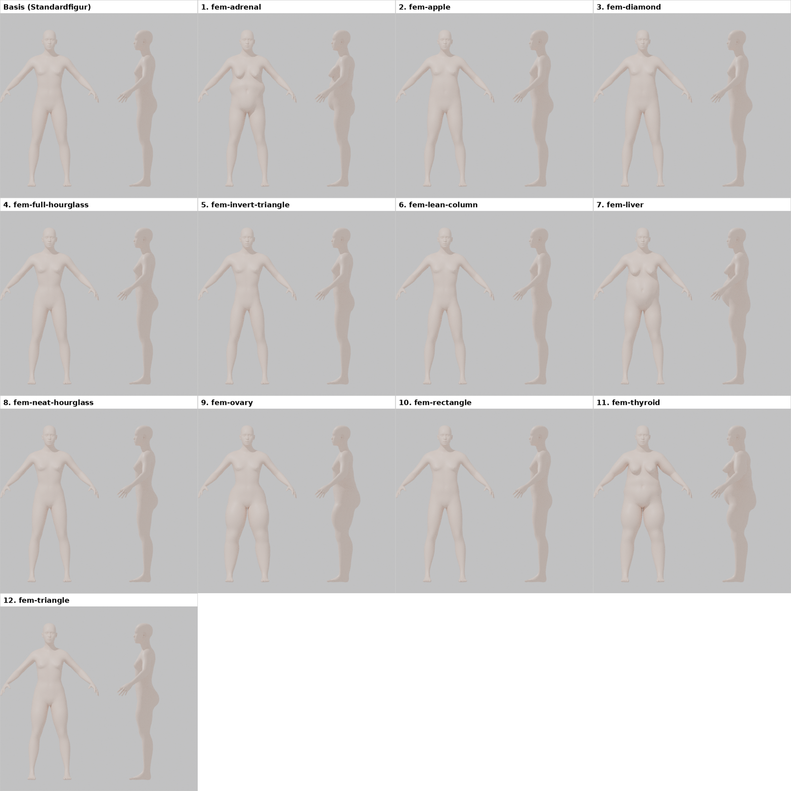
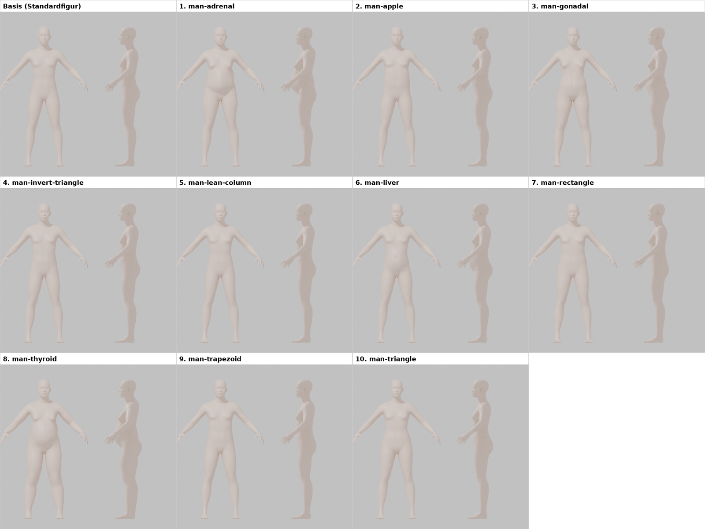

# Figurtypen: Auswahl und Begründung

Stand: 12.10.2026 · Entscheidung: Christian. Grundlage war eine Bestandsaufnahme aller 22 `bodyshapes`-Targets aus MakeHuman, jeweils voll ausgeprägt auf der neutralen Standardfigur.

Die Nummern auf den Bildern folgen der alphabetischen Reihenfolge der MakeHuman-Namen. Die Standardfigur ist geschlechtsneutral, deshalb wirken die Männer-Typen auf den Bildern weicher als auf einem männlich eingestellten Avatar.

## Ergebnis

- **20 Typen bleiben im Editor** und haben verständliche Namen bekommen. Die Zuordnung zu den neuen Target-Namen steht in `AVATAR-REGLER.md`, Abschnitt 3.5.
- **2 Typen sind raus:** `fem-adrenal` und `man-adrenal`, weil sie unnatürlich wirken (hängende Brust, Bauchfalte, tief sitzender Bauch). Sie bleiben in `Avatar_Aussehen_spaeter.blend` erhalten.
- **Hüftbetont** (`man-gonadal`) wird bei beiden Geschlechtern angeboten.
- **Füllige Figuren:** „Vollschlank" (`thyroid`) und „Bauchbetont" (`liver`) bleiben bewusst drin, damit die App auch Plus-Size-Körper gut abbildet. Zusätzlich kann man jeden Typ mit dem Gewichtsregler kombinieren.

## Warum umbenannt

Die Typen stammen aus einem MakeHuman-Zusatzpaket („elvs"). Ein Teil der Namen sind klassische Silhouetten aus der Modeberatung (apple, hourglass, triangle …). Der andere Teil ist nach Drüsen und Organen benannt (adrenal, liver, ovary, thyroid, gonadal) und stammt aus einem nicht wissenschaftlichen „Drüsentyp"-Ernährungsmodell. Solche Namen wirken wie Krankheitsbilder und sind für eine Kleidungs-App ungeeignet. Deshalb tragen alle Targets jetzt beschreibende Namen nach dem Muster `max_figur_<frau|mann>_<form>`.
