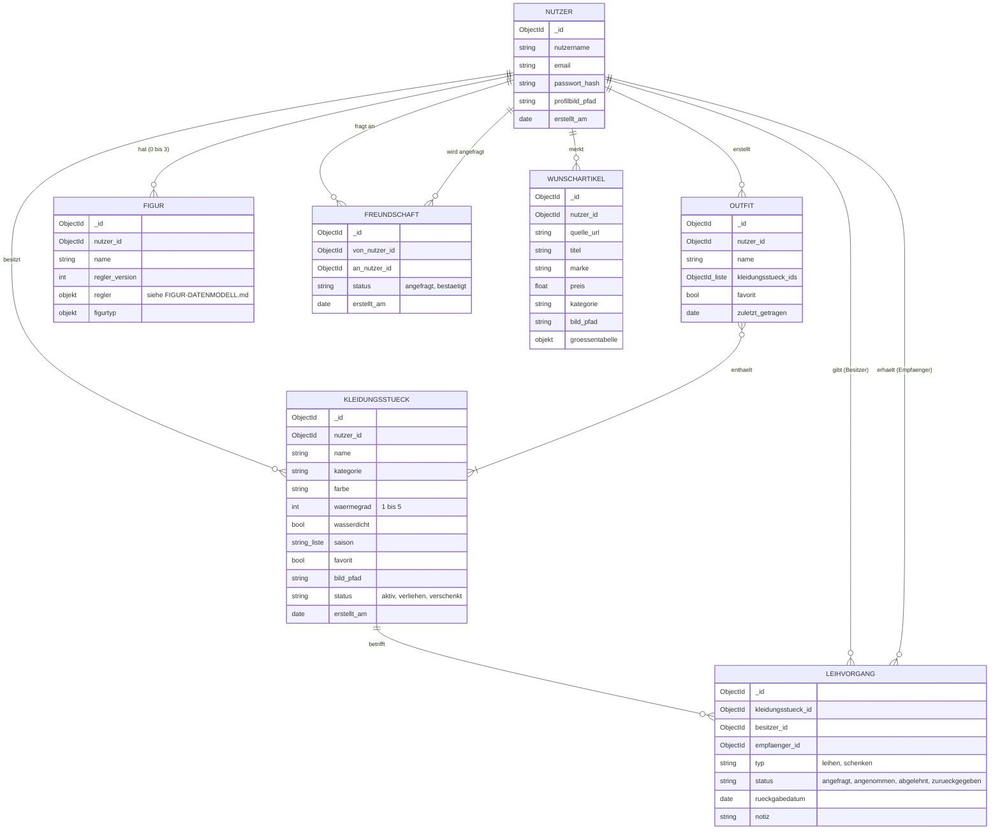

# Datenmodell (ERM → MongoDB)

Stand: 13.10.2026 · **Entwurf** von Katha/Claude(Laptop.Code) als Startpunkt für die Sprint-01-Aufgabe „Datenbankmodell festlegen". Abgeleitet aus der Technischen Konzeption (Use Cases, Wireframes), den User Stories und `docs/avatar/FIGUR-DATENMODELL.md`. Bitte im Team prüfen, anpassen und dann hier als entschieden markieren.

**Manuel arbeitet am ERM (Stand 13.10.2026).** Dieser Entwurf ist nur eine Zuarbeit; gültig ist Manuels Fassung, sobald sie steht.

## Vorgehen

1. **ERM** (fachlich): Entitäten, Attribute, Beziehungen mit Kardinalitäten, unabhängig von der Datenbank. Das Diagramm unten ist der Entwurf; die Prüfungsfassung kann z. B. mit draw.io erstellt und als Bild hier abgelegt werden (`erm.png` o. Ä.).
2. **Abbildung auf MongoDB**: Jede Entität mit eigenem Lebenszyklus wird eine Collection. Beziehungen werden als Verweis (`…_id`) gespeichert; eingebettet wird nur, was ausschließlich zu einem Dokument gehört (z. B. Reglerwerte einer Figur). Begründung je Entscheidung unten in der Tabelle festhalten (prüfungsrelevant).

## ERM-Entwurf

## Abbildung auf Collections

| Entität | Collection | Modul im Backend | Hinweise / offen |
|---|---|---|---|
| Nutzer | `nutzer` | `nutzer` | `email` und `nutzername` eindeutig (Index). Passwort nur als Hash. |
| Kleidungsstück | `kleidungsstuecke` | `kleidung` | Bild als Datei in `uploads/<nutzer_id>/`, im Dokument nur der Pfad. Kategorien: feste Liste oder eigene Collection? (offen, siehe BRAIN.md). **Umgesetzt (13.10.2026, User Story 8, Eigenschaften festgelegt von Katha):** Pflicht `kategorie` (vorläufig feste Liste: oberteile, hosen, roecke_kleider, jacken, schuhe, accessoires) und Bild (`bild_pfad`); optional `favorit` und `privat` (bool, Standard false; privat = Freunde sehen es nicht), `groesse`, `marke`, `farbe` (Freitext), `saison` (Liste aus fruehling, sommer, herbst, winter oder nur keine), `anlass` (Liste aus alltag, sport, edel), `preis` (Euro, 2 Nachkommastellen), `kaufdatum` (als Zeitpunkt 00:00 UTC gespeichert), `woher` (laden, flohmarkt, online, geklaut), `notiz` (bis 1000 Zeichen); dazu `status`, `erstellt_am`. **Keine Bezeichnung (`name`)** mehr, `waermegrad` und `wasserdicht` entfallen. Bitte in Manuels ERM abgleichen. |
| Outfit | `outfits` | `outfits` | n:m zu Kleidungsstück als Liste von IDs im Outfit. Was passiert mit Outfits, wenn ein Teil gelöscht wird? |
| Figur | `figuren` | `figuren` | Entschieden 12.10.2026, Details in `docs/avatar/FIGUR-DATENMODELL.md` |
| Freundschaft | `freundschaften` | `freunde` | Wireframes sprechen von „folgen", Konzeption von „Freundschaftsanfrage bestätigen": einseitig oder gegenseitig? |
| Leihvorgang | `leihvorgaenge` | `verleihen` | Ein Dokument je Anfrage, für Leihen und Schenken |
| Wunschartikel | `wunschartikel` | `produktimport` | Eigene Collection oder Kleidungsstück mit `status: wunsch`? (offen) |

## Datenschutz

Körpermaße (Figuren) und Kleidungsdaten sind personenbezogen. Beim Löschen eines Kontos werden alle Dokumente mit seiner `nutzer_id` und sein Upload-Ordner gelöscht.
